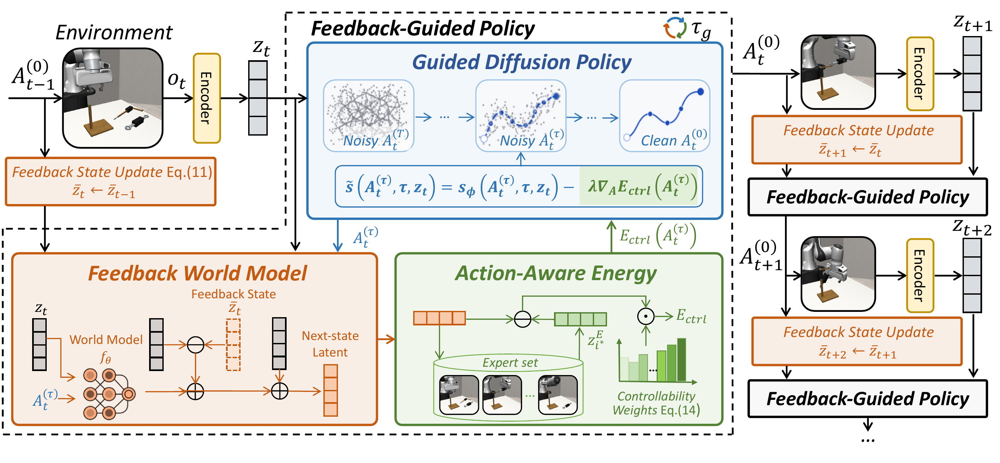

<h1 align="center">Feedback World Model Enables<br />Precise Guidance of Diffusion Policy</h1>

<p align="center">
  <a href="https://arxiv.org/abs/2605.15705"></a>
  <a href="https://arxiv.org/pdf/2605.15705"></a>
  <a href="https://ntumars.github.io/Feedback_World_Model/"></a>
  
</p>

<p align="center">
  <a href="https://morpheus-an.github.io/"><strong>Tuo An</strong></a><sup>1,*</sup> &nbsp;&nbsp;
  <a href="https://jiajindou.github.io/"><strong>Jindou Jia</strong></a><sup>1,*</sup> &nbsp;&nbsp;
  <a href="https://reagan1311.github.io/"><strong>Gen Li</strong></a><sup>1</sup> &nbsp;&nbsp;
  <a href="https://lorenzo-0-0.github.io/"><strong>Jingliang Li</strong></a><sup>1</sup> &nbsp;&nbsp;
  <a href="https://chuhaozhou99.github.io/Chuhao-Zhou/"><strong>Chuhao Zhou</strong></a><sup>1</sup>
  <br />
  <strong>Pengfei Liu</strong><sup>1</sup> &nbsp;&nbsp;
  <strong>Bofan Lyu</strong><sup>1</sup> &nbsp;&nbsp;
  <strong>Jiaqi Bai</strong><sup>1</sup> &nbsp;&nbsp;
  <a href="https://scholar.google.com/citations?hl=en&user=KWXEabIAAAAJ&view_op=list_works&sortby=pubdate"><strong>Xinying Guo</strong></a><sup>1</sup> &nbsp;&nbsp;
  <a href="https://scholar.google.com/citations?user=SZg1xeoAAAAJ&hl=zh-CN"><strong>Geng Li</strong></a><sup>1</sup> &nbsp;&nbsp;
  <a href="https://marsyang.site/"><strong>Jianfei Yang</strong></a><sup>1,†</sup>
</p>

<p align="center">
  <sup>1</sup>MARS Lab, Nanyang Technological University, Singapore
</p>

<p align="center">
  <sup>*</sup>Equal contribution &nbsp;&nbsp;&middot;&nbsp;&nbsp; <sup>†</sup>Corresponding author
</p>

<p align="center">
  
</p>

<table align="center" width="90%">
  <tr>
    <td valign="top">
      <b>Abstract.</b> World models aim to improve robotic decision making by predicting the consequences of actions. However, in practice, their predictions often become unreliable once the robot encounters states outside the training distribution, limiting their effectiveness at deployment. We observe that execution itself provides a natural but underutilized signal: after each action, the robot directly observes the true next state, revealing the mismatch between predicted and actual outcomes. Building on this insight, we propose the <b>feedback world model</b>, a new paradigm that closes the loop between prediction and observation at inference time. Instead of treating the world model as a static open-loop predictor, our method maintains a lightweight feedback state that is updated online to iteratively correct future predictions, compensating for model errors using real-time observations <b>without additional training data or parameter updates</b>. We show that this process can be interpreted as a <b>latent-space observer</b> and admits convergence guarantees under mild conditions. We further introduce <b>action-aware guidance</b> to better translate corrected predictions into control by emphasizing action-controllable components while suppressing irrelevant variations. Experiments on LIBERO-Plus, Robomimic, and real-world manipulation tasks demonstrate that our method substantially improves both prediction accuracy and policy performance under distribution shift. In particular, it reduces world model prediction error by up to <b>76.4%</b> and improves out-of-distribution (OOD) success rate by <b>30%</b>.
      <br /><br />
      
      <b>Correspondence:</b> Jianfei Yang &lt;<a href="mailto:jianfei.yang@ntu.edu.sg">jianfei.yang@ntu.edu.sg</a>&gt;
    </td>
  </tr>
</table>

<p align="center"><b>Official implementation (NeurIPS 2026)</b></p>

## Repository layout

```
train_policy.py          train the base diffusion policy
dyn_model/train.py       train the lightweight latent world model
eval_robomimic.py        Robomimic OOD evaluation:   base | guidance | fwm
eval_libero_plus.py      LIBERO-Plus evaluation:     base | guidance | fwm

fwm/                     the method
  feedback.py              feedback state           -- Sec. 4.2, Eqs. 9-12
  action_aware.py          controllability weights  -- Sec. 4.3, Eqs. 14-16
  planner.py               FeedbackGuidedPlanner    -- Algorithm 1 (energy, feedback, expert memory)
dyn_model/               latent world model (encoders, Transformer predictor, datasets, training)
diffusion_policy/        Diffusion Policy code base (pruned); guided sampling lives in
                         policy/diffusion_unet_hybrid_image_policy.py (predict_action_guided)
scripts/                 data preparation, OOD-state rendering, latent-MSE and result aggregation
tests/                   unit tests that run on CPU without any simulator
```

## Installation

```bash
conda env create -f conda_environment.yaml
conda activate fwm
pip install -e .   # optional; otherwise run every command from the repository root
```

The simulators are external dependencies (see [docs/external_simulators.md](docs/external_simulators.md)):

* **Robomimic / robosuite** are installed by the conda environment (robosuite 1.4.1, robomimic 0.3.0, MuJoCo 2.3.x, off-screen EGL rendering).
* **LIBERO** (training-time rollouts and data conversion) and **LIBERO-Plus** (the OOD evaluation protocol) are cloned next to this repository at `./LIBERO` and `./LIBERO-plus`, or pointed to with `LIBERO_ROOT` / `LIBERO_PLUS_ROOT`. LIBERO-Plus needs the small patch shipped in `third_party/libero_plus_local.patch`.
* The CLIP tokenizer used by the language-conditioned LIBERO policies is downloaded from HuggingFace (`openai/clip-vit-base-patch32`); set `CLIP_TOKENIZER=/path/to/local/copy` for offline use.

Run `python -m pytest tests` to check the installation (no simulator needed).

## Data

All experiments use publicly available demonstrations; nothing is redistributed here. The expected layout is

```
data/
  square/data/expert_demonstration/square_ph_demo.hdf5          # 200 PH demos, 140x140 images, abs_actions
  tool_hang/data/expert_demonstration/tool_hang_ph_demo.hdf5
  transport/data/expert_demonstration/transport_ph_demo.hdf5
  libero_10_single_task/<task>/<task>_demo.hdf5                 # one LIBERO-10 task per directory, absolute actions
```

**Robomimic (Square, Tool-Hang, Transport).** Download the proficient-human (PH) demonstrations from
[robomimic](https://robomimic.github.io/docs/datasets/robomimic_v0.1.html), render 140x140 image observations
with robomimic's `dataset_states_to_obs.py` (cameras: `agentview, robot0_eye_in_hand` for Square;
`sideview, robot0_eye_in_hand` for Tool-Hang; `robot0_eye_in_hand, robot1_eye_in_hand, shouldercamera0, shouldercamera1`
for Transport), then add absolute end-effector actions:

```bash
python scripts/generate_abs_actions.py data/square/data/expert_demonstration/square_ph_demo.hdf5
```

**LIBERO-10.** Download the LIBERO-10 demonstrations with the LIBERO tooling, convert them to absolute actions and
create one directory per task:

```bash
python scripts/convert_libero_to_abs_actions.py --input_dir <LIBERO>/datasets/libero_10 --output_dir data/libero_10_abs/libero_10
python scripts/prepare_libero_single_task.py --source data/libero_10_abs/libero_10
```

The four tasks of the paper (Appendix C):

| Alias | LIBERO-10 task |
| --- | --- |
| Kitchen-S3 | `KITCHEN_SCENE3_turn_on_the_stove_and_put_the_moka_pot_on_it` |
| Kitchen-S6 | `KITCHEN_SCENE6_put_the_yellow_and_white_mug_in_the_microwave_and_close_it` |
| Kitchen-S8 | `KITCHEN_SCENE8_put_both_moka_pots_on_the_stove` |
| LR-S6 | `LIVING_ROOM_SCENE6_put_the_white_mug_on_the_plate_and_put_the_chocolate_pudding_to_the_right_of_the_plate` |

## Reproducing the paper

Every task follows the same three steps. Commands are shown for Square and Kitchen-S3; substitute the task name
for the other tasks.

### 1. Base diffusion policy

```bash
# Robomimic: 20% of the PH demonstrations (40 of 200), absolute actions
python train_policy.py --config-name=robomimic_square training.device=cuda:0
# LIBERO-10 single task: all 50 demonstrations of the task (needs ./LIBERO for the training-time rollouts)
python train_policy.py --config-name=libero10_single_task \
    task_name=KITCHEN_SCENE3_turn_on_the_stove_and_put_the_moka_pot_on_it training.device=cuda:0
```

Checkpoints are written to `data/outputs/policy/<date>/<time>_<task>/checkpoints/<epoch>.ckpt` together with
`normalizer.pth`. We select the checkpoint by the in-distribution rollout success logged during training.

### 2. Latent world model

The world model reuses the frozen visual encoder of the policy checkpoint and is trained on **all** expert
demonstrations of the task with a one-step latent prediction loss (Appendix F).

```bash
# validation split: the last 10 demonstrations
python scripts/make_hdf5_subset.py data/square/data/expert_demonstration/square_ph_demo.hdf5 \
    data/square/data/expert_demonstration/square_ph_demo_val.hdf5 --last 10
python dyn_model/train.py env=square env.policy_ckpt_path=<policy .ckpt>
# LIBERO-10 single task (needs ./LIBERO)
python dyn_model/train.py env=libero10_single_task \
    task=KITCHEN_SCENE3_turn_on_the_stove_and_put_the_moka_pot_on_it env.policy_ckpt_path=<policy .ckpt>
```

Outputs go to `data/outputs/world_model/<date>/<time>_<env>/` (`checkpoints/model_<epoch>.pth`, `hydra.yaml`,
`normalizer.pth`); the paper uses the checkpoint after 200 epochs.

### 3. Evaluation under distribution shift

`mode=base` is the base policy, `mode=guidance` is open-loop world-model guidance (*Std. Guid.* in Table 1) and
`mode=fwm` is the feedback world model (*Ours*). Both protocols below are deterministic given the seed, so the three
modes are evaluated on identical initial states.

**Robomimic: robot-initial-state OOD (Appendix B).** Standard Robomimic evaluation resets the simulator from the
training distribution. Instead, every test episode starts from the initial simulator state of a demonstration the
policy was trained on, with the seven arm joint angles perturbed by Gaussian noise and clipped to the Panda joint
limits (Eq. 45):

    q̃ = clip( q + ε, q_min, q_max ),   ε ~ N(0, σ² I₇)

Gripper, object and velocity entries are left unchanged; for the dual-arm Transport task the same perturbation is
applied independently to each arm. The strength is the single parameter `robot_perturbation_scale` = σ in rad
(`0.1`, i.e. 5.7°, in the paper). Test episode *i* uses training demonstration *i* mod *N* and the random seed
`test_start_seed + i`, so the same perturbed initial states are shared by `base`, `guidance` and `fwm`.
`robot_perturbation_scale=0` falls back to the standard in-distribution evaluation (robosuite's seeded reset).
The implementation is `perturb_robot_state` in `diffusion_policy/env_runner/robomimic_image_sequential_runner.py`;
`scripts/render_ood_initial_states.py` renders an in-distribution start next to a few OOD starts (as in Figs. 7-9)
so you can check the shift before running a policy:

```bash
python scripts/render_ood_initial_states.py data/square/data/expert_demonstration/square_ph_demo.hdf5 \
    --scale 0.1 --n-states 3 --cameras agentview robot0_eye_in_hand --out square_ood_states.png
```

**LIBERO-Plus (Appendix C).** The shift comes from the benchmark itself: `eval_libero_plus.py` enumerates the
perturbed variants that LIBERO-Plus releases for a task (`categories=["Robot Initial States"]` in the main results,
`categories=null` for all five categories) and runs one episode per variant, restoring the variant's perturbed joint
configuration after the reset. There is no strength parameter to set.

#### 3a. Validate the world model first: latent prediction error

Before comparing success rates, check that the feedback reduces the world model's prediction error on your
setup (Sec. 5.2.1 / Fig. 3 and Fig. 11 of the paper). With `record_latents=true` the planner stores, for every
executed action chunk, the observed latent z_t, the open-loop prediction ẑ_{t+1} = f_θ(z_t, A_t^(0)), the
feedback-corrected prediction z^fb_{t+1} = ẑ_{t+1} + δt·l·e_t (Eq. 10) and the observed next latent z_{t+1}:

```bash
python eval_robomimic.py --config-name=robomimic_square mode=fwm record_latents=true \
    policy_checkpoint=<policy .ckpt> world_model_checkpoint=<world model .pth>
python scripts/latent_prediction_mse.py results/robomimic/square/fwm --per-episode
python scripts/latent_prediction_mse.py results/robomimic/square/fwm --plot 0 --out latent_trajectory.pdf
```

`scripts/latent_prediction_mse.py` computes the one-chunk-ahead errors

    MSE_base     = mean_j ( ẑ_{t+1,j}    − z_{t+1,j} )²
    MSE_feedback = mean_j ( z^fb_{t+1,j} − z_{t+1,j} )²

pooled over all executed chunks of all episodes (with an episode-level bootstrap standard error, plus the mean of
per-episode means), and the relative reduction (MSE_base − MSE_feedback) / MSE_base. `--plot <episode>` draws one
episode as in Fig. 11: a PCA is fitted on the observed latent trajectory, and the base prediction, the feedback
prediction and the ground truth are shown in this shared projection with time as the third axis, annotated with
the episode's reduction. All quantities live in the planner's energy latent space, i.e. the latents the guidance
acts on. A positive reduction means the feedback gain is in a useful range; a negative reduction indicates
over-correction, so lower the gain before evaluating success rates. The same works for LIBERO-Plus
(`eval_libero_plus.py ... record_latents=true`, logs in `results/libero_plus/<task>/fwm/latents/`).

#### 3b. Task success

```bash
# Robomimic: robot-initial-state OOD, 50 episodes, sigma = 0.1 rad (Appendix B)
python eval_robomimic.py --config-name=robomimic_square mode=fwm \
    policy_checkpoint=<policy .ckpt> world_model_checkpoint=<world model .pth>
# a different perturbation strength (keep the outputs apart)
python eval_robomimic.py --config-name=robomimic_square mode=fwm robot_perturbation_scale=0.2 \
    output_dir=results/robomimic/square_sigma0.2/fwm policy_checkpoint=... world_model_checkpoint=...
# LIBERO-Plus: all "Robot Initial States" variants of the task (needs ./LIBERO-plus)
python eval_libero_plus.py --config-name=libero_plus_kitchen_s3 mode=fwm \
    policy_checkpoint=<policy .ckpt> world_model_checkpoint=<world model .pth>
python scripts/summarize_results.py results/
```

Other LIBERO-Plus perturbation categories can be evaluated with
`categories='["Light Conditions"]'` (or `categories=null` for all categories).

### Environment-dependent settings

The feedback world model advances once per executed action chunk, so its update interval δt is set by the control
frequency and the action chunk of *your* policy, δt = `n_action_steps` / control frequency. The values used in the
paper (20 Hz control for both simulators) are listed for reference only:

| Task | action chunk `n_action_steps` | δt |
| --- | --- | --- |
| Square | 8 | 0.40 s |
| Tool-Hang, Transport, Kitchen-S3/S6/S8, LR-S6 | 15 | 0.75 s |

When applying the method to your own environment, derive δt from your control frequency and action chunk, and choose
the guidance strength λ, the guidance window τ_g, the optional trigger and the feedback gain l for that environment;
the per-update correction is δt·l·e_t and should satisfy 0 < δt·l ≤ 1 (Appendix A). Guidance is applied in the last
τ_g of the 100 DDPM denoising steps.

The expert memory is built from the demonstrations the policy was trained on. The energy space is the concatenated
visual latent of the policy's cameras (for Transport, the two wrist cameras); the LIBERO settings additionally include
the proprioceptive latent with weight 2. Action-aware guidance is enabled with
`planner.use_action_aware=true planner.action_aware_beta=<β>` (Eq. 15; the controllability weights are estimated
from 200 demonstration states and 32 counterfactual actions each).

## Real-world experiments

The Peach-P&P and Drawer-Open experiments run on an R1 Lite robot. The policy and world model follow the same
recipe as the simulated tasks; the Peach-P&P policy uses agent-view and right-wrist RGB and is trained from
LeRobot v2.1 data through `diffusion_policy/dataset/lerobot_replay_image_dataset.py`.
The demonstrations and the robot driver / deployment code are platform specific and not part of this release.

## Citation

```bibtex
@inproceedings{an2026feedback,
  title     = {Feedback World Model Enables Precise Guidance of Diffusion Policy},
  author    = {An, Tuo and Jia, Jindou and Li, Gen and Li, Jingliang and Zhou, Chuhao and Liu, Pengfei and
               Lyu, Bofan and Bai, Jiaqi and Guo, Xinying and Li, Geng and Yang, Jianfei},
  booktitle = {Advances in Neural Information Processing Systems (NeurIPS)},
  year      = {2026}
}
```

## Acknowledgements

This code base builds on [Diffusion Policy](https://github.com/real-stanford/diffusion_policy),
[Latent Policy Barrier](https://project-latentpolicybarrier.github.io/) (world-model guidance) and
[DINO-WM](https://github.com/gaoyuezhou/dino_wm) (world-model training), and evaluates on
[robomimic](https://robomimic.github.io/), [LIBERO](https://libero-project.github.io/) and
[LIBERO-Plus](https://github.com/sylvestf/LIBERO-plus). See [LICENSE](LICENSE) for the licenses of the
adapted code.
